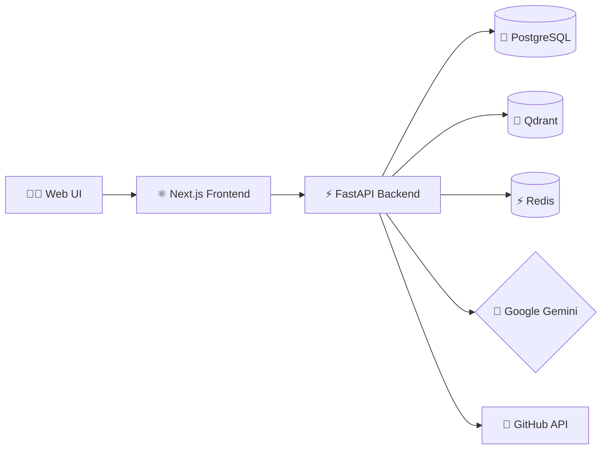
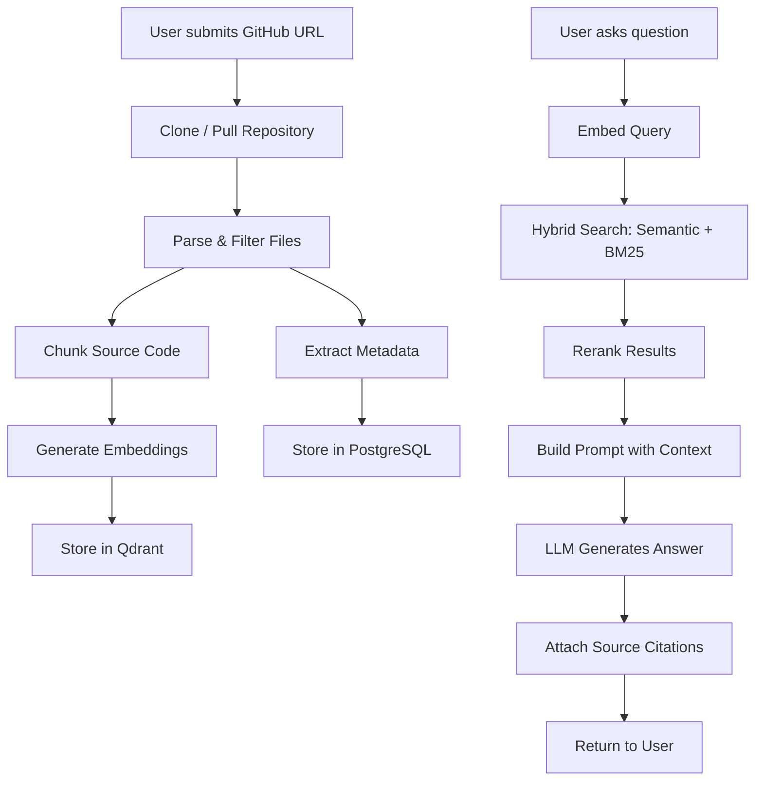

# 🧭 RepoPilot

**AI-powered GitHub Repository Intelligence Platform**

RepoPilot is a **RAG (Retrieval-Augmented Generation)** assistant that indexes GitHub repositories and enables natural-language Q&A over codebases — complete with source citations, architecture diagrams, and semantic search.

> _"Talk to any GitHub repo like it's a teammate."_

---

## ✨ Features

| Feature | Description |
|---------|-------------|
| 🔍 **Semantic Code Search** | Find code by _meaning_, not just keywords. Ask "where is authentication handled?" and get the right files. |
| 💬 **Natural Language Q&A** | Ask questions in plain English and receive grounded answers with inline source citations. |
| 📊 **Repository Summaries** | Auto-generate high-level overviews of any repository's purpose, structure, and tech stack. |
| 🔌 **API Discovery** | Automatically detect REST endpoints, GraphQL schemas, and function signatures across the codebase. |
| 📝 **README Generation** | Generate professional README files from repository contents with a single click. |
| 🐛 **Bug Detection** | Surface potential issues, anti-patterns, and code smells using LLM-powered analysis. |
| 🏗️ **Architecture Diagrams** | Generate Mermaid diagrams that visualize module dependencies and data flow. |
| 🔄 **Hybrid Search** | Combines dense vector search with BM25 keyword matching and cross-encoder reranking for maximum recall. |
| 📚 **Multi-Repository Support** | Index and query across multiple repositories simultaneously. |
| 📜 **Chat History** | Full conversation persistence with branching and context management. |

---

## 🏛️ Architecture



### Data Flow



---

## 🛠️ Tech Stack

| Layer | Technology | Purpose |
|-------|-----------|---------|
| **Frontend** | Next.js 14, TypeScript, Tailwind CSS, shadcn/ui | Responsive web UI with streaming chat |
| **Backend** | FastAPI, Python 3.11+, SQLAlchemy 2.0, Pydantic v2 | Async API server with type safety |
| **Database** | PostgreSQL 16 | Relational data: repos, chats, users |
| **Vector Store** | Qdrant | High-performance similarity search |
| **Cache** | Redis 7 | Response caching & rate limiting |
| **Embeddings** | Sentence-Transformers (`all-MiniLM-L6-v2`) | Local embedding generation |
| **LLM** | Google Gemini (2.5 Flash) | Answer generation with citations |
| **Infra** | Docker Compose, Nginx | Container orchestration & reverse proxy |

---

## 🚀 Quick Start

### Prerequisites

- [Docker](https://docs.docker.com/get-started/) & Docker Compose v2+
- A Gemini API key ([get one free](https://aistudio.google.com/apikey))

### 1. Clone & Configure

```bash
git clone https://github.com/your-username/repo-pilot.git
cd repo-pilot

# Copy and edit the environment file
cp .env.example .env
# → Set your GEMINI_API_KEY
```

### 2. Launch

```bash
# Start all services (PostgreSQL, Qdrant, Redis, Backend, Frontend)
make up

# Or use docker compose directly:
docker compose -f infra/docker-compose.yml up -d
```

### 3. Use

| Service | URL |
|---------|-----|
| 🌐 Web UI | [http://localhost:3000](http://localhost:3000) |
| 📡 API | [http://localhost:8000/api/v1](http://localhost:8000/api/v1) |
| 📖 API Docs | [http://localhost:8000/docs](http://localhost:8000/docs) |

### 4. Ingest Your First Repo

```bash
# Via the UI: paste a GitHub URL and click "Index"
# Or via CLI:
make ingest URL=https://github.com/tiangolo/fastapi
```

---

## 🔧 Development Setup

For local development with hot-reload:

```bash
# 1. Start infrastructure services
make dev

# 2. Backend (in a separate terminal)
cd backend
python -m venv .venv && source .venv/bin/activate
pip install -r requirements.txt
alembic upgrade head
uvicorn app.main:app --reload --port 8000

# 3. Frontend (in a separate terminal)
cd frontend
npm install
npm run dev
```

### Running Tests

```bash
make test           # Run all tests
make lint           # Run linters (ruff, mypy)
```

---

## 📡 API Reference

Full documentation: [`docs/api.md`](docs/api.md) or visit `/docs` when the server is running.

### Key Endpoints

| Method | Endpoint | Description |
|--------|----------|-------------|
| `POST` | `/api/v1/repositories/` | Index a new GitHub repository |
| `GET` | `/api/v1/repositories/` | List all indexed repositories |
| `GET` | `/api/v1/repositories/{id}` | Get repository details & status |
| `DELETE` | `/api/v1/repositories/{id}` | Remove a repository and its data |
| `POST` | `/api/v1/chat/` | Send a message and get an AI response |
| `POST` | `/api/v1/chat/stream` | Stream a chat response (SSE) |
| `GET` | `/api/v1/chat/sessions` | List chat sessions |
| `GET` | `/api/v1/chat/sessions/{id}/messages` | Get messages in a session |
| `POST` | `/api/v1/sources/search` | Semantic search over indexed code |
| `GET` | `/api/v1/system/health` | Health check for all services |

---

## ⚙️ Configuration

All settings are controlled via environment variables. See [`.env.example`](.env.example) for the full list.

| Variable | Default | Description |
|----------|---------|-------------|
| `LLM_PROVIDER` | `gemini` | LLM backend: `gemini` |
| `LLM_MODEL` | `gemini-2.5-flash` | Model identifier |
| `GEMINI_API_KEY` | — | Google Gemini API key |
| `QDRANT_HOST` | `localhost` | Qdrant host or cluster URL (`https://...` for Cloud) |
| `QDRANT_PORT` | `6333` | Qdrant REST port |
| `QDRANT_API_KEY` | — | (Optional) Qdrant Cloud API key for production / Render |
| `EMBEDDING_MODEL` | `all-MiniLM-L6-v2` | Sentence-Transformers model name |
| `EMBEDDING_DIMENSION` | `384` | Embedding vector size |
| `CHUNK_SIZE` | `1500` | Characters per code chunk |
| `CHUNK_OVERLAP` | `200` | Overlap between chunks |
| `MAX_FILE_SIZE_KB` | `500` | Skip files larger than this |
| `SECRET_KEY` | — | JWT signing key |
| `GITHUB_CLIENT_ID` | — | (Optional) GitHub OAuth App Client ID |
| `GITHUB_CLIENT_SECRET` | — | (Optional) GitHub OAuth App Client Secret |
| `DEBUG` | `false` | Enable debug logging |

### 🔐 GitHub Account Linking (OAuth / Personal Access Token)

RepoPilot allows you to connect your GitHub account to directly browse and index your public and private repositories:

1. **OAuth Setup (Optional)**:
   - Go to [GitHub Developer Settings → OAuth Apps](https://github.com/settings/developers).
   - Create a new OAuth App:
     - **Application name**: `RepoPilot`
     - **Homepage URL**: `http://localhost:3000`
     - **Authorization callback URL**: `http://localhost:3000/auth/callback`
   - Copy the Client ID and Client Secret into your `.env`:
     ```env
     GITHUB_CLIENT_ID=your_client_id
     GITHUB_CLIENT_SECRET=your_client_secret
     ```
2. **Personal Access Token (Zero-Config)**:
   - You can also link instantly using a GitHub Personal Access Token (classic or fine-grained with `repo` scope).

---

## 📁 Project Structure

```
repo-pilot/
├── backend/                    # FastAPI application
│   ├── alembic/                #   Database migrations
│   ├── app/
│   │   ├── api/                #   Route handlers
│   │   │   └── v1/             #     Versioned endpoints
│   │   ├── core/               #   Config, security, dependencies
│   │   ├── models/             #   SQLAlchemy ORM models
│   │   ├── schemas/            #   Pydantic request/response schemas
│   │   ├── services/           #   Business logic layer
│   │   │   ├── ingestion/      #     Repo cloning, parsing, chunking
│   │   │   ├── retrieval/      #     Search & reranking
│   │   │   └── llm/            #     LLM provider abstraction
│   │   └── main.py             #   Application entry point
│   ├── tests/                  #   Test suite
│   ├── Dockerfile
│   └── requirements.txt
├── frontend/                   # Next.js application
│   ├── src/
│   │   ├── app/                #   App Router pages
│   │   ├── components/         #   React components
│   │   ├── hooks/              #   Custom hooks
│   │   ├── lib/                #   API client, utilities
│   │   └── types/              #   TypeScript type definitions
│   ├── Dockerfile
│   └── package.json
├── infra/                      # Infrastructure & deployment
│   ├── docker-compose.yml      #   Production compose
│   ├── docker-compose.dev.yml  #   Development override
│   ├── nginx/                  #   Reverse proxy config
│   └── deployment/             #   Railway / Vercel configs
├── scripts/                    # CLI utilities
│   ├── ingest_repo.py          #   Ingest a repository
│   ├── rebuild_index.py        #   Rebuild vector index
│   └── seed_demo_data.py       #   Seed demo data
├── docs/                       # Documentation
│   ├── architecture.md         #   System architecture
│   └── api.md                  #   API reference
├── data/                       # Runtime data (git-ignored)
│   ├── repos/                  #   Cloned repositories
│   ├── uploads/                #   User uploads
│   └── samples/                #   Sample data
├── .env.example                # Environment template
├── .gitignore
├── Makefile                    # Developer convenience commands
├── LICENSE                     # MIT License
└── README.md                   # ← You are here
```

---

## 🔬 How It Works

### Ingestion Pipeline

1. **Clone** — The repository is cloned (or pulled if it already exists) from GitHub.
2. **Filter** — Binary files, vendored dependencies, and files over the size limit are excluded.
3. **Parse** — Each source file is parsed with language-aware chunking that respects function and class boundaries.
4. **Chunk** — Large files are split into overlapping chunks (default: 1500 chars, 200 overlap) to fit within embedding context windows.
5. **Embed** — Each chunk is embedded using `all-MiniLM-L6-v2` (384-dimensional vectors) running locally.
6. **Store** — Vectors are upserted into Qdrant; metadata (file paths, language, line ranges) is stored in PostgreSQL.

### Query Pipeline

1. **Embed Query** — The user's question is embedded with the same model.
2. **Hybrid Search** — Qdrant performs approximate nearest-neighbor search (HNSW); results are combined with BM25 keyword scores.
3. **Rerank** — A cross-encoder model reranks the top candidates for precision.
4. **Build Prompt** — The top-K chunks are assembled into a structured prompt with instructions for citation.
5. **Generate** — The LLM generates an answer grounded in the retrieved context.
6. **Cite** — Source references (file path, line range, relevance score) are attached to the response.

---

## 📸 Screenshots

> _Screenshots will be added after the UI is complete. Check back soon!_

<!-- 


-->

---

## 🤝 Contributing

Contributions are welcome! Here's how to get started:

1. **Fork** the repository
2. **Create** a feature branch: `git checkout -b feature/amazing-feature`
3. **Commit** your changes: `git commit -m 'Add amazing feature'`
4. **Push** to the branch: `git push origin feature/amazing-feature`
5. **Open** a Pull Request

### Development Guidelines

- Write tests for new features
- Follow existing code style (enforced by `ruff`)
- Add type hints to all function signatures
- Update documentation for API changes
- Keep commits atomic and well-described

---

## 📄 License

This project is licensed under the **MIT License** — see the [LICENSE](LICENSE) file for details.

---

<div align="center">
  <sub>Built with ❤️ by the RepoPilot team</sub>
</div>
