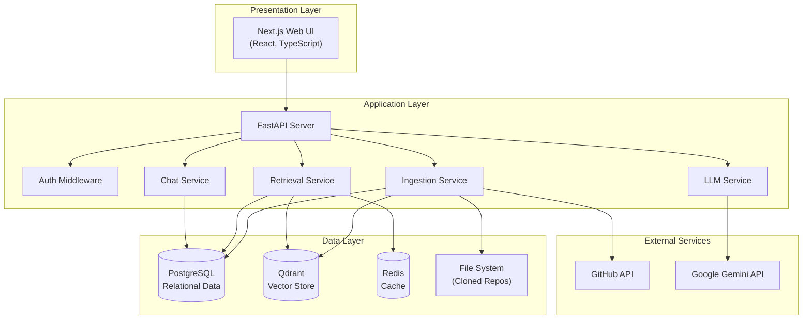
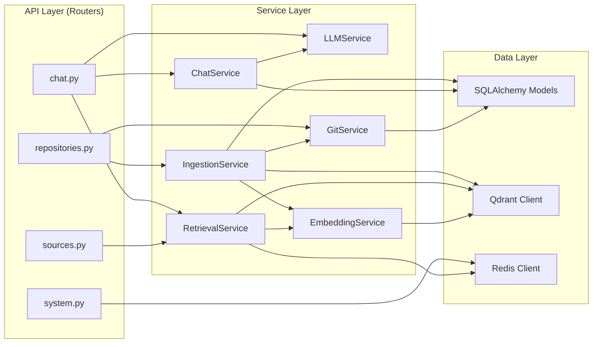
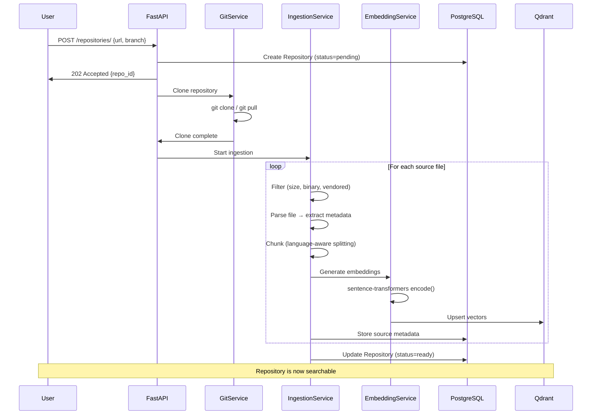
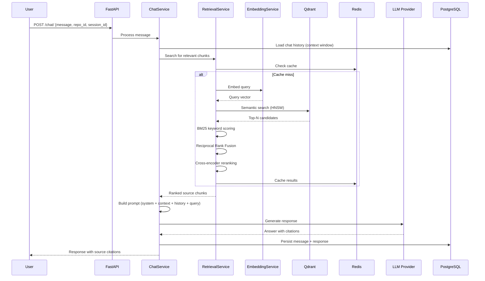
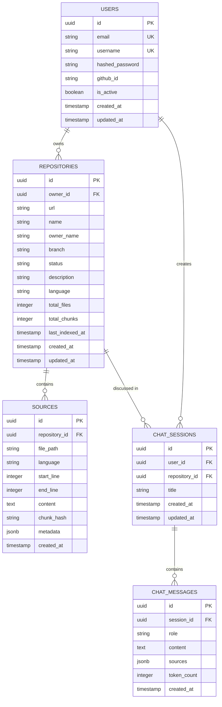
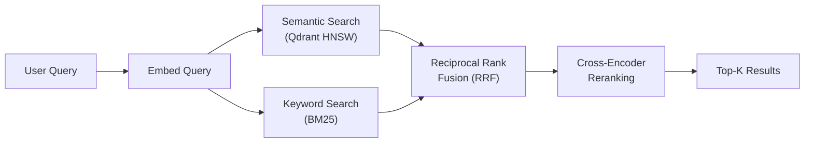
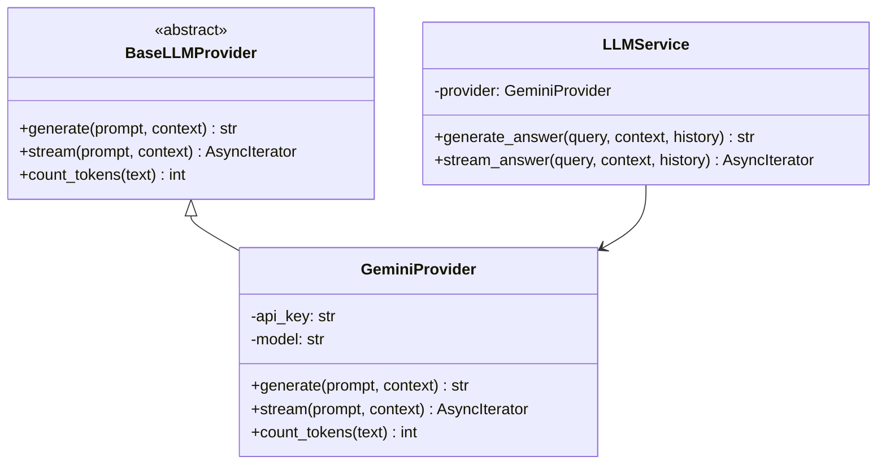

# RepoPilot — System Architecture

> Detailed architecture documentation for the RepoPilot AI-powered GitHub Repository RAG Assistant.

---

## Table of Contents

- [System Overview](#system-overview)
- [Component Architecture](#component-architecture)
- [Data Flow](#data-flow)
- [Database Schema](#database-schema)
- [Vector Store Design](#vector-store-design)
- [Chunking Strategy](#chunking-strategy)
- [Retrieval Pipeline](#retrieval-pipeline)
- [Citation Resolution](#citation-resolution)
- [LLM Integration](#llm-integration)
- [Scalability Considerations](#scalability-considerations)
- [Security Considerations](#security-considerations)

---

## System Overview

RepoPilot is a **Retrieval-Augmented Generation (RAG)** platform purpose-built for source code. It ingests GitHub repositories, chunks and embeds the code, and exposes a natural-language Q&A interface that grounds its answers in the actual codebase.

The system follows a **layered architecture** with clear separation between the presentation layer (Next.js), the application layer (FastAPI), and the data layer (PostgreSQL + Qdrant + Redis).



---

## Component Architecture

### Frontend (Next.js)

The frontend is a single-page application built with Next.js 14's App Router. Key modules:

| Module | Responsibility |
|--------|---------------|
| `app/` | Page routes and layouts (App Router) |
| `components/ui/` | Reusable UI primitives (shadcn/ui) |
| `components/chat/` | Chat interface with streaming support |
| `components/repository/` | Repository management views |
| `hooks/` | Custom React hooks (API, streaming, etc.) |
| `lib/api-client.ts` | Type-safe API client with error handling |
| `types/` | Shared TypeScript type definitions |

### Backend (FastAPI)

The backend follows a **service-oriented** pattern within a monolithic deployment:



### Service Descriptions

| Service | Responsibility |
|---------|---------------|
| **IngestionService** | Orchestrates the full ingestion pipeline: clone → parse → chunk → embed → store |
| **GitService** | Clones repositories, manages local copies, extracts file metadata |
| **EmbeddingService** | Generates vector embeddings using sentence-transformers |
| **RetrievalService** | Hybrid search (semantic + keyword), reranking, result assembly |
| **LLMService** | Google Gemini client with prompt management, streaming, and local fallback |
| **ChatService** | Manages chat sessions, message persistence, and context windows |

---

## Data Flow

### Ingestion Pipeline



### Query Pipeline



---

## Database Schema



---

## Vector Store Design

### Qdrant Collection Schema

Each indexed repository gets vectors stored in a single Qdrant collection with the following structure:

| Field | Type | Description |
|-------|------|-------------|
| `id` | UUID | Matches the `sources.id` in PostgreSQL |
| `vector` | float[384] | `all-MiniLM-L6-v2` embedding |
| `repository_id` | keyword | Filter field — scopes search to a repo |
| `file_path` | keyword | Original file path in the repository |
| `language` | keyword | Programming language of the chunk |
| `start_line` | integer | Starting line number in the source file |
| `end_line` | integer | Ending line number in the source file |
| `content` | text | The raw chunk text (stored for BM25) |

### Collection Configuration

```python
{
    "collection_name": "repopilot_chunks",
    "vectors": {
        "size": 384,
        "distance": "Cosine"
    },
    "hnsw_config": {
        "m": 16,              # Max connections per node
        "ef_construct": 100,  # Build-time search width
    },
    "optimizers_config": {
        "indexing_threshold": 20000  # Switch to HNSW after N points
    },
    "payload_schema": {
        "repository_id": "keyword",
        "file_path": "keyword",
        "language": "keyword"
    }
}
```

### Filtering

All searches are scoped to a specific repository using Qdrant's payload filter:

```python
filter = Filter(
    must=[
        FieldCondition(
            key="repository_id",
            match=MatchValue(value=str(repo_id))
        )
    ]
)
```

---

## Chunking Strategy

RepoPilot uses a **language-aware, hierarchical chunking** strategy:

### Strategy Overview

1. **File-level filtering** — Skip binary files, vendored code (`node_modules`, `.venv`), files > 500KB
2. **Language detection** — Use file extension to determine the programming language
3. **Structural splitting** — For supported languages, split on function/class boundaries
4. **Fallback splitting** — For unsupported languages, split on natural breakpoints (blank lines, then character count)
5. **Overlap** — Each chunk overlaps with adjacent chunks by 200 characters to preserve context across boundaries

### Chunk Parameters

| Parameter | Default | Description |
|-----------|---------|-------------|
| `CHUNK_SIZE` | 1500 chars | Target chunk size |
| `CHUNK_OVERLAP` | 200 chars | Overlap between consecutive chunks |
| `MAX_FILE_SIZE_KB` | 500 KB | Skip files larger than this |

### Language-Aware Boundaries

For Python, JavaScript/TypeScript, Java, Go, and Rust, the chunker recognizes:
- Function definitions
- Class definitions
- Module-level blocks
- Import sections

This ensures chunks contain semantically complete units of code rather than cutting mid-function.

---

## Retrieval Pipeline

RepoPilot uses a **hybrid retrieval** strategy combining multiple signals:



### Stage 1: Semantic Search

- The user query is embedded using the same `all-MiniLM-L6-v2` model
- Qdrant performs approximate nearest-neighbor search using HNSW
- Returns top-50 candidates with cosine similarity scores

### Stage 2: Keyword Search (BM25)

- The query is tokenized and matched against stored chunk content
- BM25 scoring captures exact keyword matches that embeddings may miss
- Returns top-50 candidates with BM25 scores

### Stage 3: Reciprocal Rank Fusion (RRF)

Combines semantic and keyword results using the RRF formula:

```
RRF_score(d) = Σ 1 / (k + rank_i(d))
```

Where `k = 60` (standard constant) and `rank_i(d)` is the rank of document `d` in the i-th result list.

### Stage 4: Cross-Encoder Reranking

- The top-20 RRF results are reranked using a cross-encoder model
- Cross-encoders jointly encode (query, document) pairs for more accurate relevance scoring
- Returns the final top-K chunks (default K=10)

### Caching

- Query results are cached in Redis with a TTL of 5 minutes
- Cache key: `search:{repo_id}:{hash(query)}`
- Cache is invalidated on re-ingestion

---

## Citation Resolution

Every answer from RepoPilot includes **source citations** that link back to the original code:

### Citation Format

```json
{
  "file_path": "src/services/auth.py",
  "start_line": 42,
  "end_line": 67,
  "repository_id": "uuid",
  "relevance_score": 0.89,
  "content_preview": "def authenticate_user(..."
}
```

### Resolution Process

1. The LLM is instructed to reference context chunks by their index (`[1]`, `[2]`, etc.)
2. The backend maps these indices back to the source metadata
3. Each citation includes the GitHub-resolvable file path and line range
4. The frontend renders citations as clickable links to the repository on GitHub

---

## LLM Integration

RepoPilot supports multiple LLM providers through a common abstraction:



### Prompt Engineering

The system prompt instructs the LLM to:
1. Answer based **only** on the provided code context
2. Use inline citations (`[1]`, `[2]`) referencing the source chunks
3. Admit when information is not available in the context
4. Format code examples with proper syntax highlighting
5. Be concise but thorough

### Context Window Management

- Chat history is truncated to fit within the model's context window
- Recent messages are prioritized over older ones
- Retrieved chunks are ordered by relevance score
- Token counting ensures the prompt stays within limits

---

## Scalability Considerations

### Current Architecture (Single-Server)

The current deployment is designed for single-server or small-team usage. All services run as containers on a single Docker host.

### Scaling Path

| Bottleneck | Solution |
|-----------|----------|
| **Embedding throughput** | GPU-accelerated inference, batch processing |
| **Concurrent queries** | Horizontal API scaling behind a load balancer |
| **Vector search latency** | Qdrant clustering, sharded collections |
| **Large repositories** | Streaming ingestion, incremental updates (diff-based) |
| **Storage** | Object storage (S3) for cloned repos instead of local disk |
| **LLM rate limits** | Provider-side rate limiting with Redis token buckets |

### Performance Targets

| Metric | Target |
|--------|--------|
| Query latency (p95) | < 3 seconds |
| Ingestion speed | ~1000 files/minute |
| Concurrent users | 50+ per instance |
| Max repository size | 100K files |

---

## Security Considerations

### Authentication & Authorization

- JWT-based authentication with configurable expiration
- Optional GitHub OAuth for SSO
- Repository access is scoped to the owning user
- API keys are never stored in plaintext

### Data Protection

- Repository clones are stored on encrypted volumes (configurable)
- Database credentials are injected via environment variables
- `.env` files are excluded from version control
- All inter-service communication is within the Docker network

### Input Validation

- All API inputs are validated with Pydantic models
- Repository URLs are validated against an allowlist of supported hosts
- File uploads are size-limited and type-checked
- SQL injection is prevented by SQLAlchemy's parameterized queries

### Rate Limiting

- Redis-backed rate limiting on all API endpoints
- Configurable per-user and per-IP limits
- LLM API calls are rate-limited to prevent cost overruns

### Dependencies

- Dependencies are pinned to specific versions
- Docker images use minimal Alpine-based bases
- Regular dependency audits with `pip-audit` and `npm audit`
